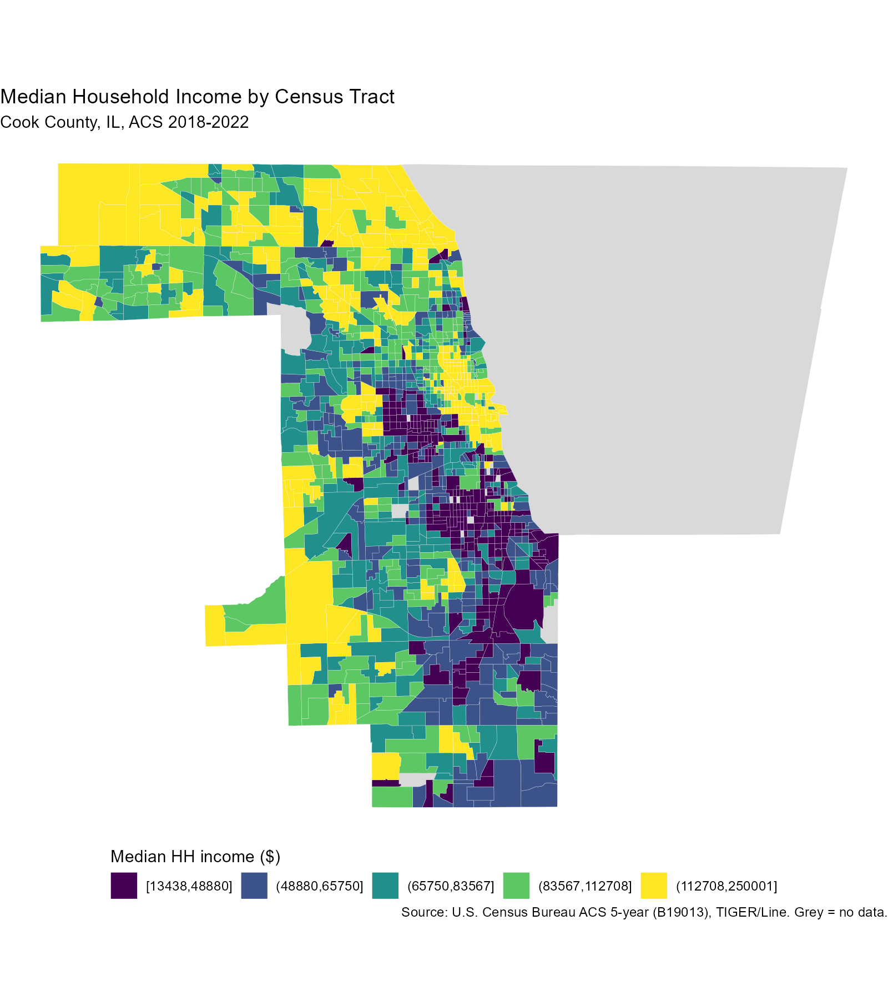
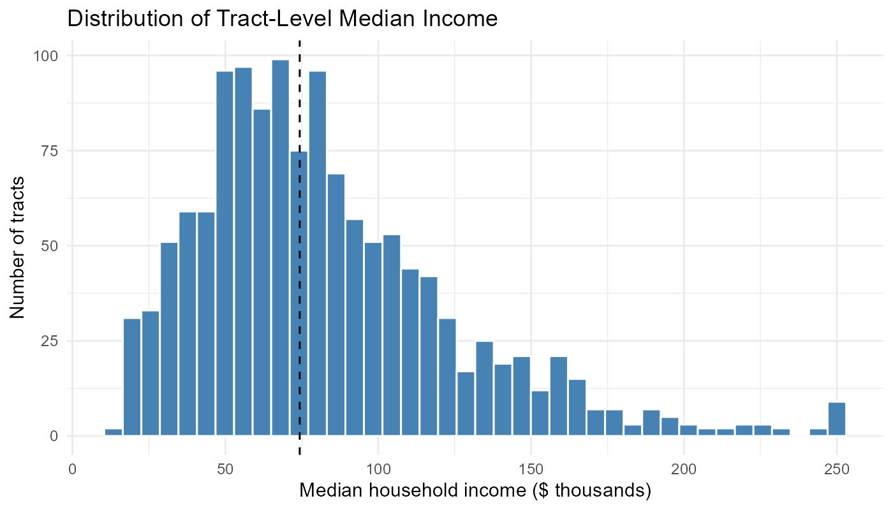
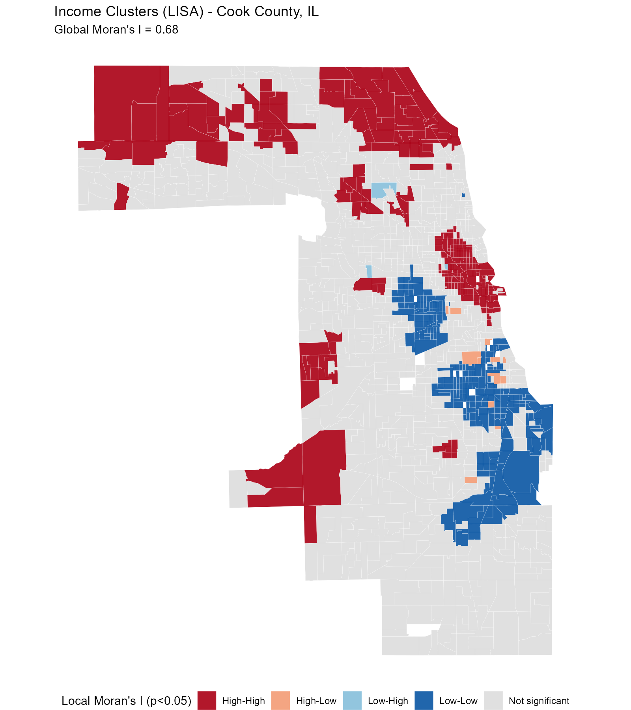

# Income Has a Geography: Mapping Neighborhood Inequality in [AREA]

## The question
Economists usually describe inequality with a single number, like a Gini coefficient. But two cities with the same Gini can look very different on the ground: in one, rich and poor households live side by side; in the other, they are sorted into separate neighborhoods. Spatial sorting matters because neighborhoods shape school quality, job access, health, and the transmission of opportunity across generations (Chetty and Hendren, 2018). So my question is: **where are high- and low-income areas concentrated in [AREA], and how strongly is income clustered in space?**

## Data and methods
I use median household income from the American Community Survey (ACS) 5-year estimates for [YEARS] (Census table B19013), at the census-tract level, merged with TIGER/Line tract boundaries from the U.S. Census Bureau. Tracts are small units (roughly 4,000 residents), so they approximate neighborhoods. Tracts with suppressed income are shown in grey.

Two tools do the work. First, a **choropleth map** shades each tract by income quintile. Second, I measure clustering with **Moran's I**, which is essentially the correlation between a tract's income and the average income of its neighbors (values near 0 mean spatial randomness, values near 1 mean strong clustering). I then use **Local Moran's I (LISA)** to flag *where* clustering is statistically significant. All code is in the repository and regenerates every figure.

## What the map shows

[Describe 2-3 key patterns using the actual figure: where the top quintile sits relative to the city center, lakefront/rivers/highways, suburbs.]

The histogram shows [spread; 90th/10th percentile ratio = X, from results/tables/summary_stats.csv].

## How clustered is it?
Global Moran's I is **[X]** (p = [X]), so a tract's income is [strongly] predicted by its neighbors' incomes.

The LISA map identifies [N] High-High tracts and [N] Low-Low tracts (see `results/tables/cluster_counts.csv`). [Interpret: Where are they? Do the boundaries between red and blue zones coincide with historical patterns such as redlining, highways, rail lines, or school district lines? Mention the few High-Low / Low-High outliers, which may mark gentrification or edge zones.]

## What the pattern reveals
- **Inequality is spatially organized, not random.** [Link to Moran's I.]
- **Segregation by income compounds disadvantage.** Low-Low clusters concentrate [exposure to X], limiting access to [schools, jobs] (cite sources).
- **Policy implication.** [e.g., place-based investment vs. mobility vouchers; zoning and housing supply.]

## Limitations
ACS estimates have margins of error, especially in small tracts. Median household income ignores wealth and cost of living. Tract boundaries are arbitrary (the modifiable areal unit problem), and Moran's I depends on how neighbors are defined.

## Takeaway
[One or two sentences: income in AREA is strongly clustered; the map shows X and the statistics confirm Y, which suggests Z.]

## Replication
Code and data instructions: see `README.md`.

**References.** U.S. Census Bureau, ACS 5-year estimates; TIGER/Line Shapefiles. Chetty, R. and Hendren, N. (2018), "The Impacts of Neighborhoods on Intergenerational Mobility," *QJE*. Anselin, L. (1995), "Local Indicators of Spatial Association," *Geographical Analysis*.
